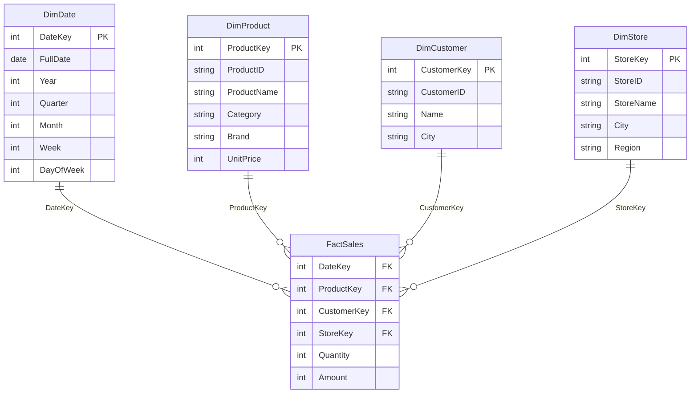

# 迷你資料倉儲：零售銷售分析

以 DuckDB 與 Python 建置的小型資料倉儲練習專案。從正規化（3NF）的模擬交易資料出發，經過 ETL 轉成 star schema，再用 SQL 完成 OLAP 分析，並與 snowflake schema 做對照。

> 本專案使用的是程式產生的模擬資料，不含任何真實個資。

## 專案目標

1. 建立 1 張事實表與 4 張維度表的 star schema。
2. 撰寫可重複執行的 ETL 腳本，並以筆數與總金額驗證載入結果。
3. 用 SQL 實作 Roll-up、Drill-down、Slice、Dice、Pivot。
4. 將 DimProduct 改為 snowflake 結構，比較 JOIN 數、執行時間與儲存空間。

## 資料流程

```
模擬 OLTP 資料（CSV，3NF）
        ↓  Extract / Transform / Load（Python、pandas）
DuckDB 資料倉儲（star schema）
        ↓  SQL
OLAP 分析（Roll-up、Drill-down、Slice、Dice、Pivot）
```

## 資料夾結構

```
mini-dw/
├── README.md
├── environment.yml
├── .gitignore
├── src/
│   ├── generate_data.py        產生模擬 OLTP 資料
│   ├── etl.py                  ETL 並載入 star schema
│   ├── run_olap.py             執行 OLAP 查詢
│   └── snowflake_experiment.py snowflake 對照實驗
├── sql/
│   ├── schema_star.sql
│   ├── schema_snowflake.sql
│   └── olap_queries.sql
├── docs/
│   └── notes.md                實驗筆記與考試重點
├── data/                       模擬 CSV（由腳本產生，不進版控）
├── warehouse.duckdb            star 倉儲（由 ETL 產生，不進版控）
└── warehouse_snowflake.duckdb  snowflake 倉儲（由實驗產生，不進版控）
```

## 環境需求

- Miniconda（Python 3.11）
- 套件：`python-duckdb`、`pandas`

## 快速開始

```bash
# 1. 建立 conda 環境並安裝套件
conda create -n mini-dw python=3.11 -y
conda activate mini-dw
conda install -c conda-forge python-duckdb pandas -y

# 2. 產生模擬 OLTP 資料（輸出到 data/）
python src/generate_data.py

# 3. 執行 ETL，建立 warehouse.duckdb
python src/etl.py

# 4. 執行 5 種 OLAP 查詢
python src/run_olap.py

# 5. 執行 snowflake 對照實驗
python src/snowflake_experiment.py
```

每次執行 `etl.py` 都會重建資料倉儲，可以放心重跑。

## 來源資料（OLTP，3NF）

| 資料表 | 主要欄位 | 筆數 |
| --- | --- | --- |
| Customers | CustomerID、Name、City | 500 |
| Products | ProductID、ProductName、Category、Brand、UnitPrice | 100 |
| Stores | StoreID、StoreName、City、Region | 10 |
| Orders | OrderID、OrderDate、CustomerID、StoreID | 20,000 |
| OrderDetails | OrderID、ProductID、Quantity | 60,119 |

分析期間為 2024 年 1 月 1 日至 2025 年 12 月 31 日，共 2 年。其中約 2% 的客戶城市刻意留白，用來練習 ETL 清洗。

## Star Schema

事實表的粒度為「一張訂單中的一個商品明細」。

| 資料表 | 類型 | 主要欄位 | 筆數 |
| --- | --- | --- | --- |
| FactSales | 事實表 | DateKey、ProductKey、CustomerKey、StoreKey；Quantity、Amount | 60,119 |
| DimDate | 維度表 | DateKey、FullDate、Year、Quarter、Month、Week、DayOfWeek | 731 |
| DimProduct | 維度表 | ProductKey、ProductID、ProductName、Category、Brand、UnitPrice | 100 |
| DimCustomer | 維度表 | CustomerKey、CustomerID、Name、City | 500 |
| DimStore | 維度表 | StoreKey、StoreID、StoreName、City、Region | 10 |



## ETL 說明

1. **Extract**：用 pandas 讀入來源 CSV。
2. **Transform**：處理缺值與重複列、統一型別、產生 DimDate、建立代理鍵、計算 `Amount = Quantity × UnitPrice`。
3. **Load**：先載入維度表，再載入 FactSales。
4. **驗證**：核對來源與倉儲的筆數與總銷售金額，不一致就中止並報錯。

驗證結果：事實表 60,119 筆，總銷售金額 44,866,135，來源與倉儲一致。

## OLAP 查詢

`sql/olap_queries.sql` 含 5 個查詢，執行 `python src/run_olap.py` 即可依序印出結果。

| 操作 | 分析問題 |
| --- | --- |
| Roll-up | 由月往上彙總到年與總計 |
| Drill-down | 由月往下展開到日 |
| Slice | 固定年份，分析各商品類別銷售額 |
| Dice | 固定年份、區域、商品類別三個維度 |
| Pivot | 商品類別 × 季度的交叉表 |

範例（Roll-up）：

```sql
SELECT d.Year, d.Month, SUM(f.Amount) AS total_amount
FROM FactSales f
JOIN DimDate d ON f.DateKey = d.DateKey
GROUP BY ROLLUP (d.Year, d.Month)
ORDER BY d.Year, d.Month;
```

## Snowflake 對照實驗

將 DimProduct 拆成 DimProduct、DimCategory、DimBrand 三張正規化的表，其餘維度不變，用同一批資料重跑相同查詢。

| 比較項目 | Star | Snowflake |
| --- | --- | --- |
| 查詢的 JOIN 數（各類別／類別加品牌） | 1／1 | 2／3 |
| 平均查詢時間（各類別／類別加品牌） | 1.22 ms／1.46 ms | 1.90 ms／2.88 ms |
| Category 與 Brand 文字值的儲存份數 | 200 | 15 |
| 資料庫檔案大小 | 5,388 KB | 6,924 KB |
| SQL 撰寫複雜度 | 較簡單 | 較複雜，多串幾層 JOIN |

兩種寫法的查詢結果完全相同。時間為每個查詢暖機後跑 5 次的平均值，在單一台電腦上實測，數字會隨環境略有不同。

在這個小資料量下，snowflake 消除了重複的文字值，但檔案反而比較大，查詢也比較慢。完整的解讀與考試重點整理在 [docs/notes.md](docs/notes.md)。

## 專案進度

- [x] 產生模擬 OLTP 資料
- [x] 建立 star schema
- [x] 完成 ETL 與驗證
- [x] 完成 5 種 OLAP 查詢
- [x] 完成 snowflake 對照實驗
- [x] 整理 ER 圖與筆記