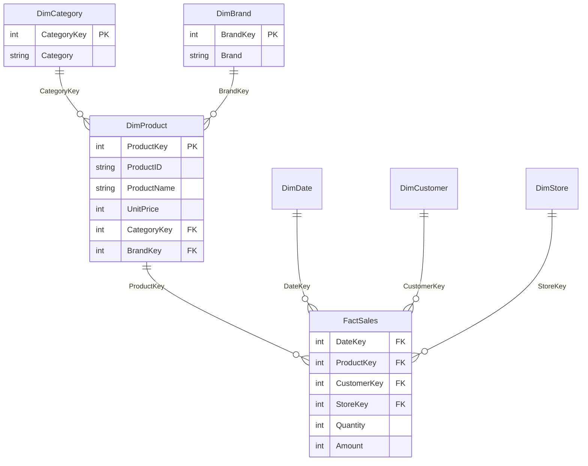

# 實驗筆記：Star 與 Snowflake 對照

## 一、實驗設定

- 資料：模擬零售銷售，事實表 60,119 筆，分析期間 2 年。
- Star：DimProduct 為單一表，同時含 Category 與 Brand 文字欄位。
- Snowflake：DimProduct 只保留商品資料與兩個外部鍵，Category 與 Brand 各拆成獨立的維度表。
- 比較的兩個問題：各商品類別的銷售額、各類別與品牌的銷售額。
- 計時方式：每個查詢先暖機一次，再跑 5 次取平均。

Snowflake 結構：

## 二、實驗結果

| 查詢 | Schema | JOIN 數 | 平均時間（ms） | 結果相同 |
| --- | --- | --- | --- | --- |
| 各類別銷售額 | Star | 1 | 1.22 | 是 |
| 各類別銷售額 | Snowflake | 2 | 1.90 | 是 |
| 各類別與品牌銷售額 | Star | 1 | 1.46 | 是 |
| 各類別與品牌銷售額 | Snowflake | 3 | 2.88 | 是 |

| 儲存項目 | Star | Snowflake |
| --- | --- | --- |
| Category 與 Brand 文字值的儲存份數 | 200 | 15 |
| 資料庫檔案大小 | 5,388 KB | 6,924 KB |

## 三、解讀

1. **JOIN 數與查詢時間**：Snowflake 每多拆一層就多一次 JOIN，兩個查詢的時間都比 star 長。與理論一致，但絕對值只有幾毫秒，在這個資料量下使用者感受不到差異。
2. **重複資料**：Star 的 DimProduct 把 Category 與 Brand 的文字重複存了 100 列（共 200 份），snowflake 只存 15 份，達到正規化消除冗餘的目的。
3. **檔案大小與預期相反**：Snowflake 檔案反而較大。可能原因有三個，我沒有逐一驗證：DuckDB 以固定大小的區塊配置空間，小資料量下無法反映節省；多出來的兩張表各自有主鍵與外部鍵的額外開銷；兩個檔案的建立方式不同。所以檔案大小不適合當作這個實驗的結論依據，真正能說明冗餘差異的是第 2 點的文字值份數。
4. **為什麼沒有看到 snowflake 省空間**：商品只有 100 列，被重複的文字也很短。冗餘要在維度表有大量列、重複值又很長時才會明顯，例如數十萬筆商品或客戶。

## 四、考試重點整理

| | Star Schema | Snowflake Schema |
| --- | --- | --- |
| 維度表 | 不正規化，一個維度一張表 | 正規化，維度再拆成子表 |
| JOIN | 少，查詢快、SQL 簡單 | 多，查詢較慢、SQL 較複雜 |
| 冗餘 | 有重複資料 | 重複資料少，一致性較好 |
| 儲存 | 大資料量時佔空間較多 | 大資料量時較省空間 |
| 適用 | 重視查詢效能與易用性 | 重視資料一致性與維護 |

答題時可用本實驗當例子：同一個問題，star 只要 1 次 JOIN，snowflake 要 2 到 3 次，結果相同，但 snowflake 把重複的 200 份文字縮成 15 份。

## 五、限制

- 資料是模擬產生的，分布比真實情況單純。
- 計時只在單一台電腦上測量，毫秒等級的差異容易受當下系統狀況影響。
- 只拆了 DimProduct 一個維度，沒有測試其他維度或更大的資料量。